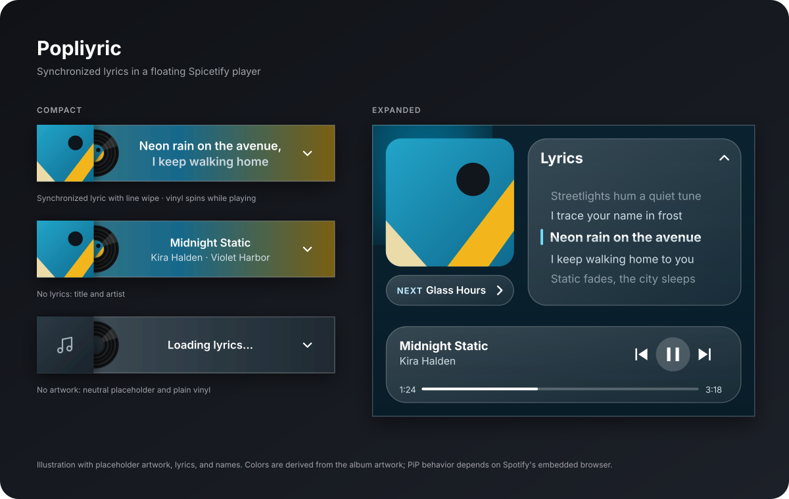

# Popliyric

Popliyric is a lightweight Spicetify extension that brings synchronized lyrics and a compact mini-player into a browser-managed Picture-in-Picture window in Spotify.

It is designed as a native extension: it does not require the companion Electron application, a local HTTP server, a build step, or npm packages.

## Overview

The extension adds a **Popliyric** button to Spotify's top bar. Click it to open or close the floating player. The compact pill shows the current lyric and album artwork. Click the pill or its arrow to expand the panel with track details, the lyric list, playback progress, and controls.

Document Picture-in-Picture is managed by Spotify's embedded browser. Its availability, resizing, and window behavior depend on the Spotify runtime, so this extension is not a replacement for an Electron-owned desktop window.

## Features

- Line-synchronized lyrics with a vertical top-to-bottom wipe.
- Ordinary lyric display when lyrics exist without usable timing data.
- Track-information mode when lyrics are missing.
- Circular vinyl artwork with subtle grooves, rotating while Spotify plays.
- Dark adaptive island color sampled from album artwork.
- Previous, play/pause, and next controls.
- Playback position, pause/resume, track changes, and seeks follow Spotify's Player state.
- Long lyric lines wrap naturally in the expanded panel; the compact preview shows up to two lines.
- One playback refresh timer while the PiP window is open; no local command polling.

## Preview

The Marketplace preview is an illustrative UI mockup, not a captured Spotify screenshot. The actual layout depends on the Spotify and Spicetify runtime.



## Technology stack

- JavaScript and CSS inside Spotify's Spicetify extension runtime.
- `Spicetify.Player` for track metadata, playback state, progress, and controls.
- `Spicetify.Platform.RequestBuilder` for Spotify's Color Lyrics endpoint.
- Document Picture-in-Picture for the separate browser-managed player surface.
- Canvas sampling for adaptive album color; no third-party runtime dependencies.

## Requirements

- Spotify desktop with Spicetify installed and applied.
- A Spotify runtime that exposes the Document Picture-in-Picture API.
- Access to Spotify's internal Color Lyrics endpoint for lyric responses.

Lyrics and runtime APIs are controlled by Spotify and may change. Tracks without lyric responses use Track Information Mode.

## Installation

### Spicetify Marketplace

The repository format is prepared for Marketplace metadata. Popliyric is **not listed yet**: discovery requires a public GitHub repository with the `spicetify-extensions` topic and a root `manifest.json` accepted by Marketplace. See the official [Marketplace publishing requirements](https://github.com/spicetify/marketplace/wiki/Publishing-to-Marketplace).

Once the repository is public and listed, open Marketplace in Spotify, find Popliyric under Extensions, and select **Install**.

### Manual installation

1. Copy `popliyric.js` into `%appdata%\spicetify\Extensions\` on Windows, or `~/.config/spicetify/Extensions/` on Linux/macOS.
2. Enable it with `spicetify config extensions popliyric.js`.
3. Apply the change with `spicetify apply`.
4. Restart Spotify if the Popliyric button does not appear.

Spicetify's [extension guide](https://spicetify.app/docs/customization/extensions) documents these installation paths.

## Usage

1. Start Spotify and play a track.
2. Click **Popliyric** in the top bar.
3. Click the pill or its arrow to expand or collapse the player.
4. Use the previous, play/pause, and next controls in the expanded panel.
5. Click **Popliyric** again or close the PiP window to dismiss it.

The extension must open the PiP window from a user gesture. Native hover expansion from the original Electron app is not available to this extension.

## Configuration

There are no user settings or external configuration files in this version. The window size is requested by the extension and may be adjusted by the browser or user.

## Architecture

```text
Spotify desktop
└── Spicetify extension (popliyric.js)
    ├── Spicetify.Player: metadata, progress, playback state, controls
    ├── Spicetify.Platform.RequestBuilder: lyric retrieval
    └── Document Picture-in-Picture: compact and expanded UI
```

The Electron reference remains in the original `spotify-dynamic-island` project and is not included in this extension package. The native extension calls Spotify Player methods directly and has no Electron IPC, preload bridge, local server, or background command process.

## Project structure

```text
popliyric-spicetify/
├── popliyric.js         # Spicetify extension entry point
├── manifest.json        # Marketplace metadata
├── preview.svg           # Illustrative Marketplace preview
├── README.md             # Project documentation
├── CONTRIBUTING.md       # Contributor guidance
├── CHANGELOG.md          # Released and unreleased changes
├── MIGRATION_PLAN.md     # Source audit and migration record
├── LICENSE               # MIT License
└── .gitignore
```

## Troubleshooting

### The Popliyric button is missing

- Confirm Spicetify is applied and `popliyric.js` is enabled.
- Restart Spotify after applying the extension.
- Check Spotify's developer console for `[Popliyric]` errors.

### The PiP window does not open

- Open it by clicking the top-bar button; the browser requires a user gesture.
- Confirm this Spotify runtime exposes Document Picture-in-Picture.
- Apply Spicetify again after Spotify updates if extension injection stopped working.

### Track information appears instead of lyrics

Spotify may not return lyrics for that track, or the internal lyric endpoint may be unavailable. The island will show the artwork, title, artist, and album instead of presenting a false synchronized state.

### The vertical wipe is not moving

The wipe needs line timing data. Unsynchronized lyric text is still shown normally. Seeking and playback events re-anchor the effect to Spotify's current position.

## Known limitations

- The Color Lyrics endpoint is an internal Spotify interface, not a stable public API.
- Document Picture-in-Picture is browser-managed. The extension cannot guarantee arbitrary screen placement, native hover detection, window chrome, or identical always-on-top behavior across Spotify builds.
- PiP resizing may be restricted by the embedded browser. The content remains responsive inside the available window size.
- Spotify or the operating system may throttle animation frames while the app is in the background. The extension recalculates lyric position from Spotify when playback events or refreshes resume.
- The collapsed pill opens by click; Electron's native hover behavior is not reproduced.

## Development

The extension is a single JavaScript file and has no build step. Edit `popliyric.js`, copy it to the Spicetify Extensions directory, and run `spicetify apply`. Keep changes incremental and verify the interface in Spotify rather than relying on mock data alone.

## Roadmap

- Capture actual Spotify screenshots for the Marketplace listing.
- Verify live long-session behavior across foreground and background playback.
- Confirm Document PiP behavior across supported Spotify runtimes.
- Publish the repository with the Marketplace topic after the release review.

## Contributing

See [CONTRIBUTING.md](CONTRIBUTING.md) for the development workflow, conventions, and pull request guidance.

## Acknowledgements

Popliyric's original Electron implementation is retained as a visual and behavioral reference. The native extension uses Spicetify and Spotify runtime capabilities directly. The user-provided Spictify Lyric Miniplayer repository was also reviewed as a reference for a separate lyrics window.
